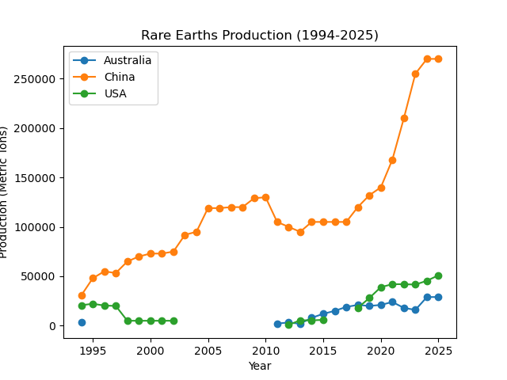
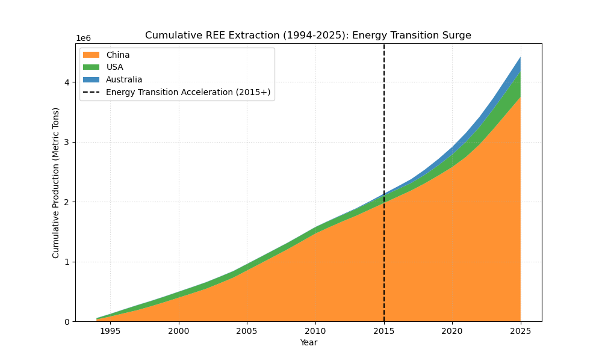

Rare Earth Elements (REE) **  What is the Transition Really Consuming ?

Hi there, it's me ✌️
Every day, we hear about electric vehicles, high-efficiency wind turbines, and the global race toward net-zero emissions.
But every clean energy revolution is built on physical matter extracted from the ground. 
And that made me ask a fundamental question: "Who are the actual hosts providing the raw materials to make it happen?" 👇

To dig deeper into this, I turned to historical extraction data from the U.S. Geological Survey (USGS), focusing on the primary global producers: **China, the United States, and Australia**.

   ### DATA REVEAL ### ------------------------------------------------------------
Rather than just focusing on average growth rates (CAGR) , additionally wanted to look both the yearly production flow and the all-time cumulative extraction.

1. Annual Production: Changing Roles on the Stage (1994–2025)
   

  # In the mid-1990s, the US was playing an active role in production then operations ceased in the early 2000s, which lead to China to almost entirely host the world's raw material needs.
  # Around 2015, production lines took a sharp turn upward. While Australia and the US gradually re-entered the scene to diversify the supply chain, the sheer scale of expansion was largely driven by one single player.

 2. Cumulative Extraction: Who Actually Carried the Burden?
    

  # Cumulative extraction grew linearly until 2014, then surged steeply after 2015 due to surging demand for EV and wind turbine magnets (NdFeB). 
  # Looking at the total volume mined over the past 30 years, the majority of historical producing comes from a single host. 
  
  🛠️ Data Pipeline & Methods 🛠️
  
  # Source: U.S. Geological Survey (USGS) historical datasets.
  # Data cleaning: bypassed raw data using ('skiprows = 6'), normalized column structures (`Production (t)`), outer-joined datasets on `Year`, and filled operational pauses with `.fillna(0)`.
  # Cumulative metrics: used Pandas `.cumsum()` to calculate historical resource depletion and analyzed the shift between the Pre-Transition Era (1994–2015) and the Energy Transition Era (2016–2025).


  🚀 How to Run Locally

```bash
# Clone the repository
git clone [https://github.com/](https://github.com/)<your-username>/<your-repo-name>.git
cd <your-repo-name>

# Install required dependencies
pip install pandas matplotlib

# Run the analysis scripts
python cagr.py
python cumulative_analysis.py

